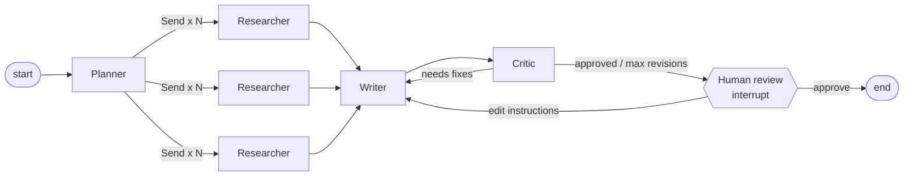

# LangGraph Multi-Agent Researcher

A research assistant built as a LangGraph state machine. It splits a question into sub-questions, researches them in parallel, writes a cited report, has a critic agent review it, and pauses for human approval before finishing.

## How it works



| Agent | Job | Output |
|---|---|---|
| Planner | Breaks the question into 3-5 sub-questions | Structured output (`Plan`) |
| Researcher | Web search (Tavily) and fact summary with source URLs, one branch per sub-question | `Note` |
| Writer | Markdown report from notes, applies critic or human feedback | Draft |
| Critic | Checks unsupported claims, missing citations and gaps | Structured output (`Review`) |
| Human review | `interrupt()` pauses the graph, resumes with `Command(resume=...)` | Approve or edit |

LangGraph features used: `StateGraph`, reducers for parallel results (`Annotated[list, operator.add]`), map-reduce with `Send`, conditional edges, checkpointing (`MemorySaver`), human-in-the-loop with `interrupt` and `Command`.

## Run

```bash
pip install -e ".[search,dev]"
export ANTHROPIC_API_KEY=... TAVILY_API_KEY=...
research "How do RAG systems reduce hallucinations, and what are their limits?"
```

## Tests

```bash
pytest
```

Tests swap the LLM agents for stubs, so they check graph routing (fan-out, revision loop, revision cap, human approve and edit) offline.
